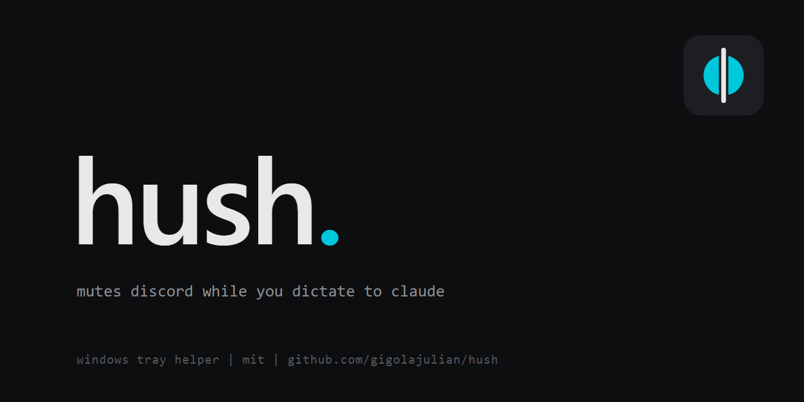

# Hush

Mutes you on Discord while you dictate to the Claude desktop app. Unmutes you when you stop, but only if Hush did the muting.

Windows and macOS (14 or later). One tray or menu bar icon. About 0.02% CPU.

## How it works
- Every 250 ms it checks whether the Claude app is capturing your mic: Windows audio sessions, or CoreAudio on macOS (no mic permission needed).
- When you start dictating, it asks Discord whether you're muted. If you aren't, it mutes you.
- When you stop, it unmutes you only if it muted you and you're still muted. If you muted yourself first, it leaves you alone.

Tray icon: a dot with a vertical line through it. Grey while watching, cyan while Hush holds a mute. Right-click for status, version, Pause, Quiet mute, Check for updates, Auto update and Quit.

Hush only acts while you are in a Discord voice call. **Quiet mute** skips Discord's mute sound: instead of muting, Hush sets your Discord mic volume to 0 while you dictate and puts it back after. People in the call won't see a muted icon. If Hush stops mid-dictation, it restores the volume at next start.

## Install
You need the Discord desktop app, and Python 3.10+ to build Hush.

1. **Make your own Discord app.** Hush talks to Discord through its local RPC API, which needs an app you own.
   - Go to https://discord.com/developers/applications and click **New Application**. Name it Hush.
   - Open **OAuth2**. Under **Redirects**, add `http://localhost` and save.
   - Copy the **Client ID**. Click **Reset Secret** and copy the secret.
2. **Run the installer** from this folder. On Windows:
   ```
   powershell -ExecutionPolicy Bypass -File install.ps1
   ```
   It builds `Hush.exe`, installs it for you only (no admin) in `%LOCALAPPDATA%\Programs\Hush`, adds Hush to the Start menu, to Settings > Installed apps and to start at login, and starts it. It asks for the Client ID and secret once, then saves them as user env vars (`DISCORD_CLIENT_ID`, `DISCORD_CLIENT_SECRET`). The secret is never shown or written to this folder. Run it again to rebuild and reinstall; it replaces a copy that ran `hush.py` with pythonw.

   On macOS:
   ```
   ./install.sh
   ```
   It asks for the same two values and saves them in `~/Library/Application Support/Hush/keys.json`, readable only by you. A login item starts Hush in the menu bar.
3. **Authorize once.** Join a voice channel and dictate in Claude. Discord shows an Authorize popup. Accept it.

Hush starts at login from then on.

## Updates
Hush checks GitHub for a new release at startup and once a day, and installs it when you aren't dictating. It never restarts mid-dictation. Right-click the tray icon for **Check for updates**, or untick **Auto update** to turn it off. The installed Windows app downloads the release's `Hush.exe`, swaps it in and restarts. A zip install gets its files replaced. Either way only after the signature checks out against the key built into Hush. A git clone only tells you a release is out: update it with `git pull` yourself.

## Release an update
1. Bump `VERSION` in `hush.py`, commit and push.
2. `.venv\Scripts\python scripts/build.py` builds `dist\Hush.exe` for that version (or run `install.ps1`, which builds and installs it).
3. `gh release create v<version> --generate-notes`.
4. `node scripts/sign-release.js --upload` zips the tag, signs the zip and the exe, and uploads `hush-v<version>.zip`, `hush-v<version>.exe` and their `.sig` files. Installs refuse an update without them.

The key is `~/.release-keys/updates-ed25519.pem` on Julian's PC (or the file `RELEASE_SIGNING_KEY` points to). It never goes in a repo. If it is lost, installed copies can't update again, so keep a backup.

## Uninstall
On Windows: Settings > Installed apps > Hush > Uninstall, or:
```
powershell -ExecutionPolicy Bypass -File install.ps1 -Uninstall
```
Your Discord keys and login token stay.

On macOS: `./install.sh --uninstall`.

## Files
- `hush.py`: the app.
- `test_hush.py`: self-check for the mute logic.
- `install.ps1` / `install.sh`: installers for Windows and macOS. `uninstall.ps1` is copied next to the exe.
- `scripts/build.py`: builds `dist\Hush.exe` with PyInstaller (one file, no console, the Hush icon).
- `%LOCALAPPDATA%\Programs\Hush\` (Windows): the installed `Hush.exe`.
- `%LOCALAPPDATA%\Hush\` (Windows) or `~/Library/Application Support/Hush/` (macOS): log and Discord login token. Delete `token.json` to authorize again.

## Limits
- If you mute yourself while dictating, Hush can't tell that apart from its own mute and unmutes you when you stop.
- Task Manager shows two Hush.exe processes: a small launcher and the app. That is one Hush. A second launch exits by itself.
- Discord only allows voice control for the app's owner and its App Testers, which is why each user makes their own app.

Not affiliated with Anthropic or Discord.

## License
MIT
