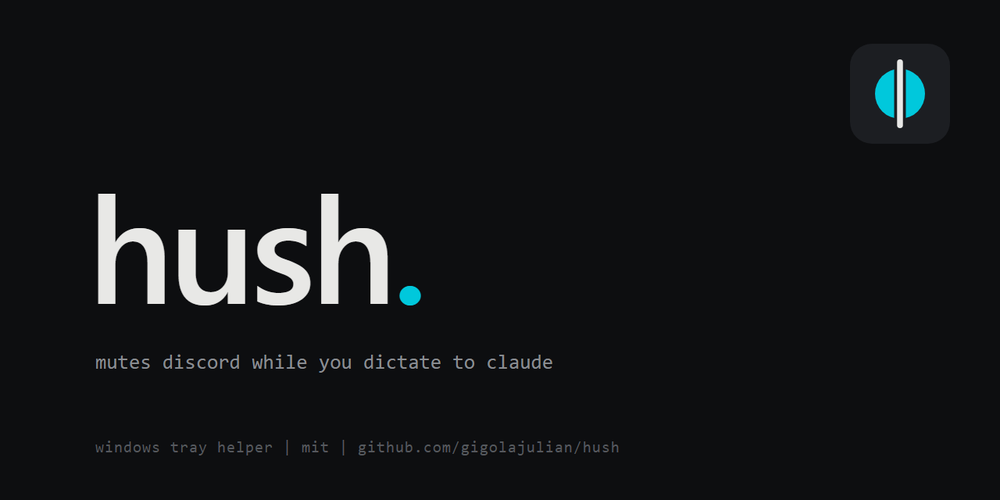

# Hush

Mutes you on Discord while you dictate to the Claude desktop app. Unmutes you when you stop, but only if Hush did the muting.

Windows only. One tray icon. About 0.02% CPU.

## How it works
- Every 250 ms it checks whether the Claude app is capturing your mic (Windows audio sessions).
- When you start dictating, it asks Discord whether you're muted. If you aren't, it mutes you.
- When you stop, it unmutes you only if it muted you and you're still muted. If you muted yourself first, it leaves you alone.
- It goes idle while Apex Legends or Easy Anti-Cheat runs.

Tray icon: the h and dot, no tile. The dot is grey while watching, cyan while Hush holds a mute. Right-click for Pause and Quit.

## Install
You need Python 3.10+ and the Discord desktop app.

1. **Make your own Discord app.** Hush talks to Discord through its local RPC API, which needs an app you own.
   - Go to https://discord.com/developers/applications and click **New Application**. Name it Hush.
   - Open **OAuth2**. Under **Redirects**, add `http://localhost` and save.
   - Copy the **Client ID**. Click **Reset Secret** and copy the secret.
2. **Run the installer** from this folder:
   ```
   powershell -ExecutionPolicy Bypass -File install.ps1
   ```
   It asks for the Client ID and secret, then saves them as user env vars (`DISCORD_CLIENT_ID`, `DISCORD_CLIENT_SECRET`). The secret is never shown or written to this folder.
3. **Authorize once.** Join a voice channel and dictate in Claude. Discord shows an Authorize popup. Accept it.

Hush starts at login from then on.

## Uninstall
```
powershell -ExecutionPolicy Bypass -File install.ps1 -Uninstall
```

## Files
- `hush.py`: the app.
- `test_hush.py`: self-check for the mute logic.
- `%LOCALAPPDATA%\Hush\`: log and Discord login token. Delete `token.json` to authorize again.

## Limits
- If you mute yourself while dictating, Hush can't tell that apart from its own mute and unmutes you when you stop.
- Discord only allows voice control for the app's owner and its App Testers, which is why each user makes their own app.

Not affiliated with Anthropic or Discord.

## License
MIT
